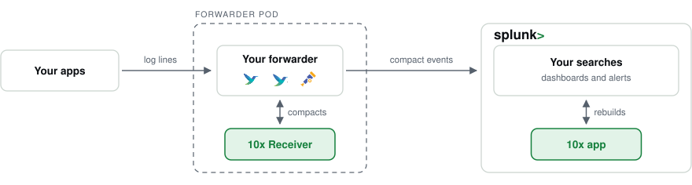
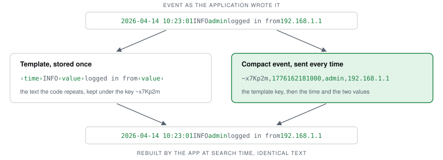
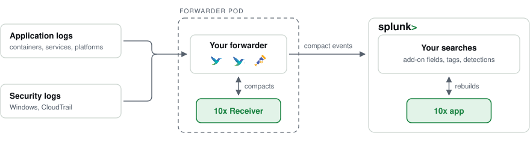

# Log10x App

[](https://opensource.org/licenses/MIT)

Splunk indexes shorter events and searches them as the original text. The [10x Receiver](https://doc.log10x.com/apps/receiver/) compacts each event beside your forwarder, and this open-source app rebuilds it in Splunk at search time.

<picture>
  <source media="(prefers-color-scheme: dark)" srcset="docs/img/where-10x-runs-dark.svg">
  
</picture>

## One event

Repeated text is stored once, as a template, and each event is sent as its values.

<picture>
  <source media="(prefers-color-scheme: dark)" srcset="docs/img/one-event-dark.svg">
  
</picture>

## Search

Searches, dashboards and alerts run on the original text. A search puts the `tx` macro in front of its terms:

```spl
index=app_logs `tx` error "payment failed"
```

Classic dashboards keep their SPL. An alert created in the **Compile Alert** view is compiled once into an ordinary saved search.

## Security Sources

The `txf` macro gives expanded events the fields, event types and tags of their original sourcetype, and the field map tool makes compact events readable by data models and detections. Setup: [Fields of the Original Sourcetype](tenx-for-splunk/README.md#fields-of-the-original-sourcetype-txf), [the Field Map](tenx-for-splunk/README.md#data-models-and-detections-the-field-map), [What to Install on Each Tier](tenx-for-splunk/README.md#what-to-install-on-each-tier).

<picture>
  <source media="(prefers-color-scheme: dark)" srcset="docs/img/sources-dark.svg">
  
</picture>

## Quickstart

### Prerequisites

| Requirement | Description |
|-------------|-------------|
| Splunk Enterprise | 9.4 through 10.6 |
| Admin Access | Required for app installation and KV Store setup |

### Step 1: Install Splunk App

Install from Splunkbase, or clone the repository into your Splunk apps directory:

```bash
git clone https://github.com/log-10x/splunk-app.git
cp -r splunk-app/tenx-for-splunk $SPLUNK_HOME/etc/apps/
$SPLUNK_HOME/bin/splunk restart
```

In a distributed deployment, install the app on the search heads and on the indexers or heavy
forwarders that parse compact events. The compact sourcetype's parsing settings, `TRUNCATE` and
the event time, apply on the instance that parses the data. [What to Install on Each Tier](tenx-for-splunk/README.md#what-to-install-on-each-tier) lists every tier.

### Step 2: Create the Index and HEC Tokens

Create an index named `tenx_dml` for templates, then two HTTP Event Collector tokens: one for templates, one for compact events.

**Templates Token:**

| Setting | Value |
|---------|-------|
| Name | `tenx-templates` |
| Source type | `tenx_dml_raw_json` |
| Index | `tenx_dml` |

**Encoded Events Token:**

| Setting | Value |
|---------|-------|
| Name | `tenx-encoded` |
| Source type | `tenx_encoded` |
| Index | Your target index |

### Step 3: Configure the Receiver and Forwarder

Start the Receiver with `receiverOptimize true`, `varMaxRecurIndexes 0`, `timestampZone UTC` and `timestampMaxPerObject 1` (see [Receiver settings](docs/REFERENCE.md#receiver-side-configuration)), and point your forwarder at both tokens: templates to `tenx_dml`, and each compact event as the message with the record's metadata as indexed fields. The [setup guide](https://doc.log10x.com/apps/receiver/compact/splunk/) has the Fluent Bit and Fluentd configuration.

### Step 4: Point the Dashboards at Your Index

Set the `tenx-events` macro to your compact index under **Settings > Advanced search > Search macros**, for example `index=my_compact_index sourcetype::tenx_encoded`. Every `tx` search starts with this macro too, so it uses the indexed form `sourcetype::`.

### Step 5: Load Existing Templates

The **Consume KV** saved search stores new templates every five minutes. To load templates indexed before the app was installed, or during an outage of that search, run this search once as an admin or power user:

```spl
index=tenx_dml sourcetype=tenx_dml_raw_json earliest=-30d | sendalert tenx_dml_to_kv
```

Widen `earliest` to reach older templates. Running it again is safe: templates already stored are kept, and their records are brought up to date when this version of the app derives them differently. The app's **Backfill KV** saved search holds the same search; its alert action fires only when the search runs on a schedule or with `sendalert`, not from the **Run** button. To load every template record ever indexed, use `earliest=0`.

### Step 6: Verify End-to-End

Run these SPL queries to confirm everything is working:

**Check templates are arriving:**
```spl
index=tenx_dml sourcetype=tenx_dml_raw_json | head 10
```

**Check KV store is populated:**
```spl
| inputlookup tenx-dml-lookup | stats count
```

**Check compact events expand:**
```spl
index=your_logs_index `tx` | head 10
```

<a id="receiver-side-configuration"></a>

## More

- [Setup guide](https://doc.log10x.com/apps/receiver/compact/splunk/): forwarder configuration and troubleshooting
- [Reference](docs/REFERENCE.md): Receiver settings, how search works, dashboards and components
- [Save-time alerts](SAVE_TIME_ALERTS.md): how alerts on compact events are compiled and kept current
- [License usage benchmark](https://github.com/log-10x/benchmarks/tree/main/splunk-license): the same logs sent to Splunk as written and compact
- [Blog post](https://www.log10x.com/blog/cutting-splunk-log-storage/?utm_source=github&utm_medium=readme&utm_campaign=splunk-app&utm_content=blog): search compact logs in Splunk using the 10x app
- [Log10x MCP server](https://doc.log10x.com/apps/mcp/): a cost report per log pattern from a sample of your own Splunk data

## License

The app is open source under the [MIT License](LICENSE). The 10x Receiver is free on up to 10 nodes, with no license token and no expiry; above 10 nodes it takes a paid license ([pricing](https://www.log10x.com/pricing?utm_source=github&utm_medium=readme&utm_campaign=splunk-app&utm_content=footer)).

## Contributing

Contributions are welcome as pull requests to this repository.

## Support

Open an issue on [GitHub](https://github.com/log-10x/splunk-app/issues), or write to [support@log10x.com](mailto:support@log10x.com).
